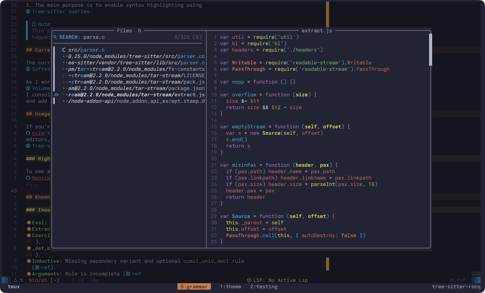

# .dotfiles

My personal macOS set up. This repository uses [GNU stow](https://www.gnu.org/software/stow/)
to manage configurations and [Homebrew Bundle](https://docs.brew.sh/Brew-Bundle-and-Brewfile)
to automate software installation.



## Essential Apps

- [Homebrew](https://brew.sh/)
- [Karabiner-Elements](https://karabiner-elements.pqrs.org)
- [Raycast](https://www.raycast.com/):
  - Window Management
  - Clipboard
  - Directory
- [Ghostty](https://ghostty.org/)
- [Calibre](https://calibre-ebook.com/download_osx)
- [DeepSeek Harness](https://deepseek.com/en/harness/)
- [Tailscale](https://tailscale.com/download)
- [Zima Client](https://www.zimaspace.com/zimaos/download?pos=home_banner_download)
- [Atuin](https://atuin.sh/)

## Step-by-Step Installation

1. Clone the repository in your root directory.
    Using HTTPS:

    ```bash
    git clone https://github.com/aruzdh/.dotfiles.git
    ```

    Using SSH:

    ```bash
    git clone git@github.com:aruzdh/.dotfiles.git
    ```

1. Run the Brew Bundle.

    ```bash
    cd ~/.dotfiles
    brew bundle
    ```

    Some packages require a post-installation step. Check the output at the end
    of the whole process.

    > [!warning]
    > This Bundle installs `mactex`, so the installation process could be (too)
    > long. It downloads around 7–8 GB.

1. Inside `~/.dotfiles`, `stow` the desired configuration. For example, for nvim

    ```bash
    stow nvim
    ```

## Repository Structure

Configurations are organized into "packages" that `stow` can map:

- `ghostty/`: Terminal emulator
- `nvim/`: Neovim setup (LazyVim-based).
- `zsh/`: Shell configuration, including aliases, exports, and functions.
- `tmux/`: Session management and pane multiplexing.
- `gitconfig/`: Global git rules
- `starship/`: Shell prompt configurations.
- `qutebrowser/`: Keyboard-driven web browser setup. (deprecated by brew)

## SSH and GPG keys

1. Create and set up your
  [SSH](https://docs.github.com/en/authentication/connecting-to-github-with-ssh/about-ssh)
  and
  [GPG](https://docs.github.com/en/authentication/managing-commit-signature-verification/about-commit-signature-verification)
  keys.

1. Create `~/.dotfiles/gitconfig/.gitconfig.local`, and `stow` it, with your
  personal details:

    ```ini
    [user]
      name = Your Name
      email = your_email@example.com
      signingkey = YOUR_GPG_KEY_ID
    ```

## Tmux

Clone the [TPM](https://github.com/tmux-plugins/tpm/tree/e261deb1b47614eed3400089ce7197dc68acc4eb)
repository.

Run the following commands:

```bash
git clone https://github.com/tmux-plugins/tpm ~/.tmux/plugins/tpm
tmux source ~/.tmux.conf # or use `prefix + r`
```

Finally, type `prefix + I` to install the plugins.
